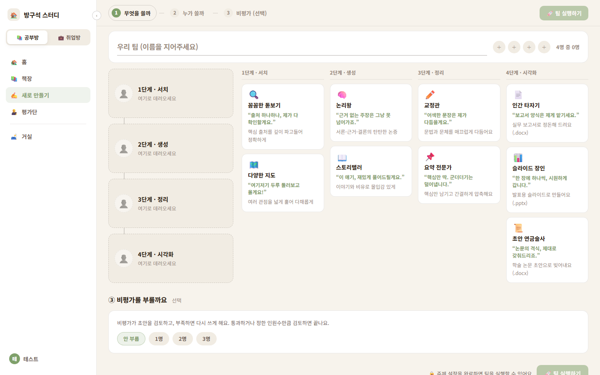
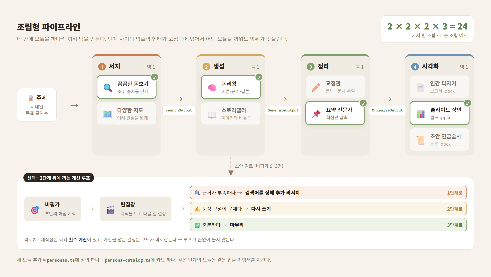
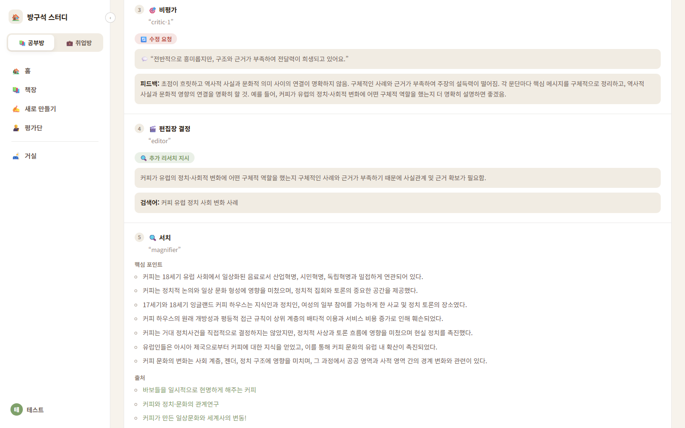
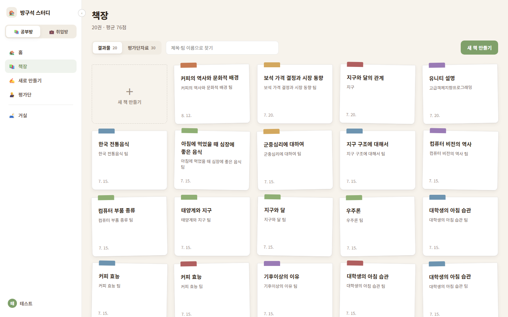
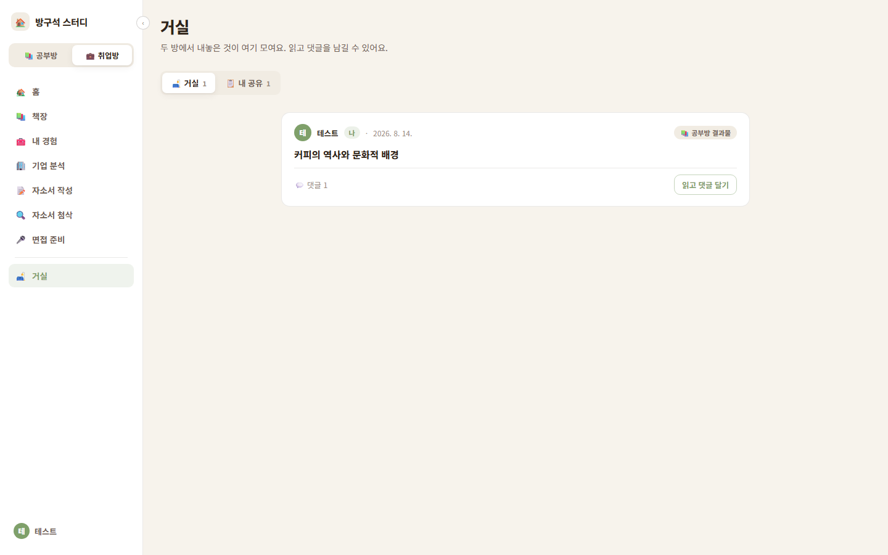
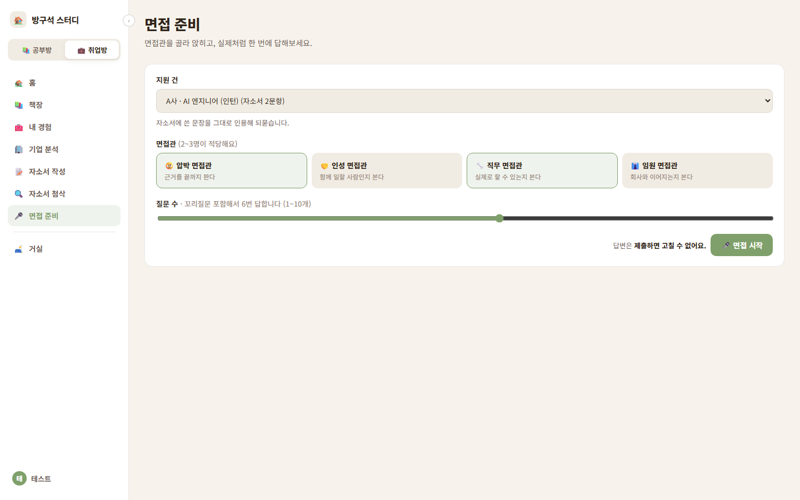

# 방구석 팀플

**단계마다 원하는 AI 모듈을 끼워 넣어, 나만의 글쓰기 팀을 조립하는 웹 서비스**

리서치 → 초안 → 정리 → 출력, 네 단계의 빈자리에 성격이 다른 모듈(페르소나)을 골라 꽂으면
그 조합대로 팀이 움직여 글 한 편을 완성합니다. 같은 주제라도 어떤 팀을 짜느냐에 따라
깊게 파고든 논증형 보고서가 나오기도 하고, 이야기처럼 풀어낸 발표 슬라이드가 나오기도 합니다.



> 개인 프로젝트 · 1인 개발 · 2026.07 약 1주 개발 (이후 2026.08 취업방·거실 등 기능 확장)
> 배포는 종료했고, 아래 스크린샷은 로컬 환경에서 찍은 것입니다.

---

## 핵심 아이디어: 조립형 파이프라인



이게 되는 이유는 **단계 사이의 약속(입출력 형태)을 먼저 고정했기 때문**입니다.

| 단계 | 받는 것 | 내놓는 것 |
| --- | --- | --- |
| 서치 | 주제 | `SearchOutput` — 출처 목록 + 핵심 포인트 |
| 생성 | 핵심 포인트 | `GenerateOutput` — 제목 + 본문 |
| 정리 | 초안 | `OrganizeOutput` — 다듬은 제목·본문 + 손본 내용 |
| 시각화 | 정리된 글 | `VisualizeOutput` — 형식(report·slides·paper) + 섹션 배열 |

같은 단계의 모듈은 모두 같은 형태를 받고 같은 형태를 내놓습니다([`lib/pipeline-types.ts`](lib/pipeline-types.ts)).
그래서 앞뒤 단계는 옆 칸에 누가 앉았는지 몰라도 되고, 모듈 하나를 새로 추가할 때도
[`lib/personas.ts`](lib/personas.ts)에 정의 하나, [`lib/persona-catalog.ts`](lib/persona-catalog.ts)에 카드 하나만 더하면 됩니다.
고른 조합은 `Assembly`로 DB에 저장되어, 어떤 팀이 어떤 글을 썼는지 남습니다.

### 팀 안에서 일어나는 일: 비평가와 편집장

조립한 네 칸 사이에는 **선택적으로 비평가를 부를 수 있습니다.** 비평가가 초안을 지적하면,
편집장이 그 지적의 성격을 보고 팀에게 다음 일을 시킵니다.

- 사실·근거가 부족하다 → 서치 모듈에게 **검색어를 정해 추가 리서치** 지시
- 문장·구성이 문제다 → 생성 모듈에게 **다시 쓰기** 지시
- 충분하다 → **마무리**

뼈대(네 단계의 순서)는 고정하고, 이 개선 루프의 분기만 LLM이 정하게 했습니다.
리서치·재작성에는 횟수 예산이 있고, 편집장이 예산을 넘는 선택을 하면 코드가 바로잡기 때문에
루프가 끝없이 돌거나 비용이 새지 않습니다. ([`lib/agents/orchestrator.ts`](lib/agents/orchestrator.ts))



<sub>결과 화면의 "팀이 한 일" 기록. 비평가가 "근거가 부족하다"고 하자 편집장이 검색어를 정해 리서치를 다시 시키고, 서치 모듈이 새 자료를 가져온 흐름이 남아 있습니다.</sub>

생성이 진행되는 동안에는 각 단계와 편집장의 판단이 SSE(Server-Sent Events)로 화면에 실시간으로 흘러나옵니다.

---

## 화면

| 책장 — 팀이 만든 결과물 | 거실 — 결과물 공유와 댓글 |
| --- | --- |
|  |  |

### 같은 구조를 취업 준비에 적용한 "취업방"

조립형 팀이라는 아이디어를 자소서·면접으로 넓혀본 공간입니다.
경험 정리 → 기업 분석(회사 정체 · 흐름 · 경쟁 + 채용공고 분석) → 자소서 작성·첨삭 → 모의 면접이
지원 건 하나로 이어집니다. 모의 면접에서도 면접관(압박 · 인성 · 직무 · 임원)을 골라 패널을 짭니다.



---

## 만들면서 신경 쓴 것

LLM에게 맡기면 불안정한 일은 코드로 확인하고, 결과를 다시 LLM에게 돌려주는 방식을 여러 곳에 썼습니다.

- **목표 글자수 맞추기** — LLM은 글자수를 정확히 세지 못합니다. 코드로 세서 "지금 N자, 목표까지 M자"를
  알려주고 다시 쓰게 하는 루프를 돌려 목표 ±50자 안으로 수렴시킵니다. ([`length.ts`](lib/agents/length.ts))
- **자소서의 "AI 티" 점검** — 상투어, 접속사 반복, 문장 길이의 단조로움처럼 셀 수 있는 것은
  LLM에게 묻지 않고 규칙으로 셉니다. 더 정확하고 비용이 들지 않습니다. ([`ai-tells.ts`](lib/agents/essay/ai-tells.ts))
- **평가단 토론의 중복 발언 거르기** — 여러 평가자가 같은 지적을 표현만 바꿔 반복하지 않도록
  새 발언이 기존 발언과 실질적으로 같은지 판정합니다. ([`discussion.ts`](lib/agents/discussion.ts))
- **한글 문서 업로드** — txt(EUC-KR 자동 감지), docx, hwpx에 더해 **hwp 5.x 바이너리**를
  CFB 컨테이너와 zlib 압축 레코드를 직접 풀어서 읽습니다. ([`parse-doc.ts`](lib/parse-doc.ts))
- **스트리밍 안정성** — 청크가 이벤트 중간에서 잘려 도착하는 경우를 버퍼로 이어 붙이고,
  스트림이 끊겨도 화면이 진행 중 상태에 갇히지 않게 했습니다. ([`sse.ts`](lib/sse.ts), [`sse-client.ts`](lib/sse-client.ts))
- **공유는 스냅샷으로** — 공유 시점에 보여줄 필드만 따로 떠서 저장합니다. 나중에 원본 모델에
  필드가 늘어나도 공유 화면으로 새어 나가지 않습니다. ([`snapshot.ts`](lib/share/snapshot.ts))
- **비용 관측** — 모든 LLM 호출이 [`lib/ai.ts`](lib/ai.ts) 한 곳을 거치며, 호출마다 토큰과 비용을
  `ApiUsage`에 기록합니다. 입력 길이 상한과 유저별 실행 횟수 제한도 걸어두었습니다.
- **인증** — JWT 쿠키 + bcrypt. 로그아웃하면 `tokenVersion`을 올려 이미 발급된 토큰을 모두 무효화합니다.

---

## 기술 스택

| 영역 | 사용 기술 |
| --- | --- |
| 프레임워크 | Next.js 16 (App Router), React 19, TypeScript |
| 스타일 | Tailwind CSS v4 |
| DB / ORM | PostgreSQL, Prisma |
| 인증 | JWT(httpOnly 쿠키), bcryptjs |
| LLM | OpenAI `gpt-4.1-nano` |
| 웹 검색 | Tavily |
| 문서 출력 | `docx`(Word), `pptxgenjs`(PowerPoint) |
| 배포 | Netlify (현재 종료) |

---

## 직접 실행해보기

Node.js 20과 Docker가 필요합니다.

```bash
git clone https://github.com/cnamorose/bangguseok-teamplay.git
cd bangguseok-teamplay

cp .env.example .env       # 값 채우기 (아래 표 참고)
npm install                # postinstall에서 prisma generate 자동 실행
docker compose up -d       # 로컬 Postgres (호스트 포트 15432)
npx prisma migrate deploy  # 스키마 적용
npm run dev                # http://localhost:3000
```

| 환경 변수 | 필수 | 설명 |
| --- | --- | --- |
| `DATABASE_URL` | ✅ | `.env.example` 값 그대로 두면 docker compose의 DB에 붙습니다 |
| `JWT_SECRET` | ✅ | 아무 긴 임의 문자열 |
| `OPENAI_API_KEY` | AI 기능에 필요 | [OpenAI](https://platform.openai.com/api-keys)에서 발급. 본인 키로 과금됩니다 |
| `TAVILY_API_KEY` | AI 기능에 필요 | [Tavily](https://app.tavily.com)에서 발급 (무료 플랜 있음) |

API 키 없이도 서버는 뜨고 회원가입·화면 둘러보기는 됩니다.
글 생성, 기업 분석, 첨삭, 면접 같은 AI 기능을 쓰려면 두 키가 필요합니다.
기본 모델은 저렴한 `gpt-4.1-nano`라서 글 한 편에 드는 비용은 크지 않습니다.

---

## 프로젝트 구조

```
app/
  study/        공부방 — 책장 · 새로 만들기(팀 조립) · 평가단
  career/       취업방 — 내 경험 · 기업 분석 · 자소서 작성/첨삭 · 면접
  living/       거실 — 공유 피드
  api/          라우트 핸들러

lib/
  pipeline-types.ts  단계별 입출력 약속 (조립의 기준)
  personas.ts        끼워 넣을 수 있는 모듈 정의
  agents/
    orchestrator.ts  네 단계 실행 + 비평가·편집장 개선 루프
    search · generate · organize · visualize · critic
    company/ essay/ experience/ interview/   취업방 에이전트
  ai.ts              LLM 호출 단일 진입점 (비용 기록)
  sse.ts             진행 상황 스트리밍

prisma/schema.prisma  데이터 모델 (설계 의도는 주석에)
```

---

## 아쉬운 점

- **LLM을 다루는 방식이 프롬프트와 규칙 기반 검증에 머물렀습니다.** 각 모듈의 차이도 시스템 프롬프트 한 단락뿐이라,
  모듈마다 다른 도구나 검색 전략을 쓰게 하지는 못했습니다. 출력은 JSON 모드로 받아 직접 파싱했고,
  스키마를 강제하는 Structured Outputs나 function calling은 쓰지 않았습니다. 웹 검색 결과도 프롬프트에
  그대로 붙였을 뿐, 임베딩 기반 검색(RAG)은 적용하지 못했습니다.
  24가지 팀이 실제로 얼마나 다른 글을 쓰는지, 편집장 루프가 글을 얼마나 낫게 만드는지도 수치로 확인하지 못했습니다.
  다음에는 이런 기법과 평가셋 기반 품질 측정을 직접 다뤄보고 싶습니다.
- **조립의 자유도가 아직 낮습니다.** 단계 사이의 입출력은 고정했지만, 시각화·정리 단계 일부는
  모듈 id로 분기하는 코드가 남아 있어서 완전히 "끼우기만 하면 되는" 상태는 아닙니다.
  모듈이 자기 출력 형식까지 스스로 들고 다니게 바꾸는 것이 다음 단계였습니다.
- **테스트가 없습니다.** 글자수 루프, AI 티 점검, 문서 파싱처럼 LLM과 무관한 로직부터 붙일 수 있습니다.
- **요청 제한이 인메모리입니다.** 서버 인스턴스가 여러 개면 정확하지 않습니다. 1인 프로젝트 규모에서 택한 절충입니다.
